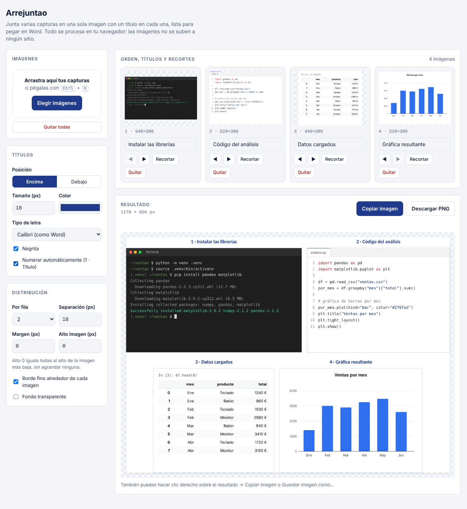
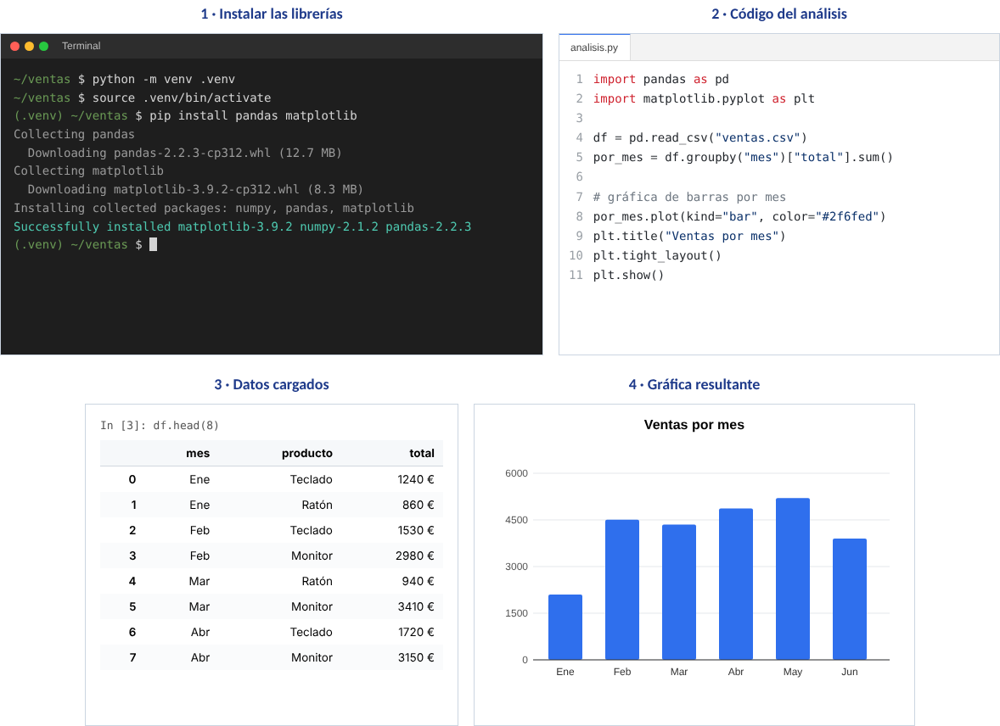

# Arrejuntao

Junta varias capturas en una sola imagen con un título en cada una, lista para pegar en Word.

Pensado para los trabajos de clase: cuando tienes que poner varias capturas seguidas en un documento y quieres que queden alineadas, del mismo tamaño y cada una con su texto.

Todo se procesa en tu navegador: las imágenes no se suben a ningún sitio.

## Qué hace

- **Añadir imágenes** arrastrándolas, eligiéndolas o pegándolas con `Ctrl + V` (ideal con `Win + Shift + S`).
- **Un título por imagen**, encima o debajo, con tamaño, color, tipo de letra y negrita a elegir. Opción de numerarlas automáticamente (`1 · Título`).
- **Recortar** cada imagen arrastrando sobre la zona que quieres conservar. Con *Aplicar a todas* el mismo recorte se aplica al resto (si tienen otro tamaño, en proporción).
- **Ordenar** las imágenes y elegir cuántas van por fila.
- **Igualar el alto** de todas para que queden alineadas sin deformarse, o fijar un alto concreto.
- **Separación, margen, borde fino y fondo transparente** opcionales.
- **Exportar**: copiar la imagen al portapapeles para pegarla en Word, o descargarla en PNG.

Los ajustes se recuerdan en el navegador para la próxima vez. Las imágenes no se guardan.

## Cómo se usa

1. Añade tus capturas.
2. Escribe el título de cada una y ordénalas con ◀ ▶.
3. Recorta si hace falta.
4. Ajusta el aspecto en el panel de la izquierda.
5. Pulsa **Copiar imagen** y pégala en Word con `Ctrl + V`, o **Descargar PNG**.

Resultado con cuatro capturas, dos por fila y con los títulos numerados:

## Cómo funciona

Es un único archivo `index.html` con HTML, CSS y JavaScript, sin dependencias ni proceso de compilación.

La imagen final se dibuja en un `<canvas>`: para cada captura se calcula su tamaño escalado al alto común, se pinta el recorte con `drawImage` y se escribe el título con `fillText`, partiéndolo en líneas con `measureText` si no cabe. El resultado se convierte a PNG con `canvas.toBlob()`.

## Licencia

[MIT](LICENSE)
